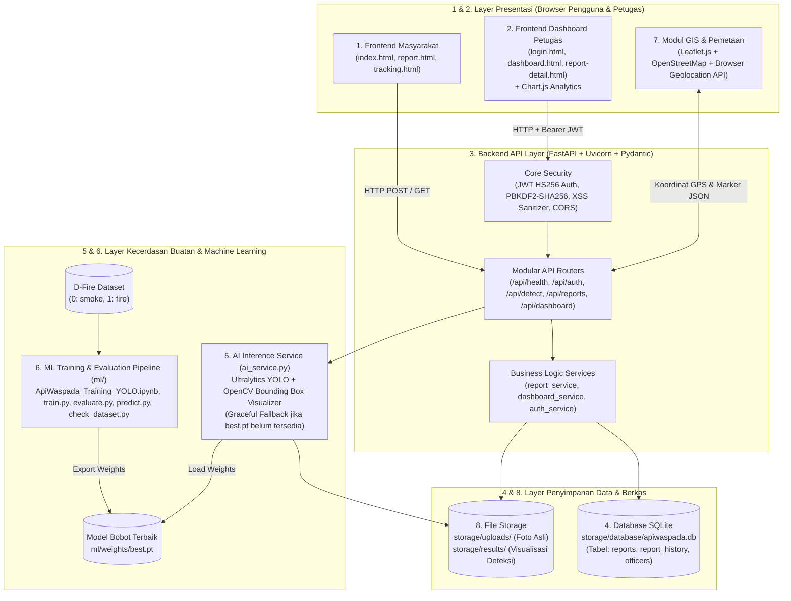

# Dokumentasi Arsitektur Sistem ApiWaspada Kota Jambi

**Judul Sistem:** Sistem Cerdas Deteksi Visual Api dan Asap serta Pelaporan Berbasis Lokasi untuk Mendukung Penanganan Kebakaran di Kota Jambi.

---

## 1. Diagram Arsitektur Modular (8 Komponen Utama)



---

## 2. Diagram Arsitektur ASCII (Untuk Terminal & Teks Murni)

```text
+-----------------------------------------------------------------------------------+
|                        BROWSER PENGGUNA & PETUGAS (CLIENT)                        |
|                                                                                   |
|  +-------------------------------+       +-------------------------------------+  |
|  |   1. Frontend Masyarakat      |       |   2. Frontend Dashboard Petugas     |  |
|  |  - index.html (Landing Page)  |       |  - login.html (Autentikasi JWT)     |  |
|  |  - report.html (Form + Kamera)|       |  - dashboard.html (KPI + Chart.js)  |  |
|  |  - tracking.html (Cek Status) |       |  - report-detail.html (Verifikasi)  |  |
|  +---------------+---------------+       +------------------+------------------+  |
|                  |                                          |                     |
|                  +--------------------+---------------------+                     |
|                                       |                                           |
|                     +-----------------v-----------------+                         |
|                     |   7. Modul GIS & Pemetaan         |                         |
|                     |  - Leaflet.js + OpenStreetMap     |                         |
|                     |  - Browser Geolocation API        |                         |
|                     +-----------------+-----------------+                         |
+---------------------------------------|-------------------------------------------+
                                        | REST API (JSON / Multipart Form-Data)
                                        v
+-----------------------------------------------------------------------------------+
|                      3. BACKEND FASTAPI (backend/app/)                            |
|                                                                                   |
|  +-----------------------------------------------------------------------------+  |
|  | Keamanan: Validasi MIME/Pillow, Anti-Path Traversal, XSS Escape, JWT, CORS |  |
|  +-----------------------------------------------------------------------------+  |
|  | Routes  : health.py | auth.py | detect.py | reports.py | dashboard.py       |  |
|  +-----------------------------------------------------------------------------+  |
|  | Services: report_service.py  | dashboard_service.py   | auth_service.py     |  |
|  +-------------------+----------------------------------------+----------------+  |
|                      |                                        |                   |
|                      v                                        v                   |
|  +---------------------------------------+    +-------------------------------+   |
|  | 5. AI Inference Service               |    | 4. Database SQLite (ORM)      |   |
|  |    (ai_service.py)                    |    |  - Tabel: reports             |   |
|  |  - Ultralytics YOLO (Fire & Smoke)    |    |  - Tabel: report_history      |   |
|  |  - OpenCV Bounding Box Visualizer     |    |  - Tabel: officers            |   |
|  |  - Graceful Fallback Mode             |    +-------------------------------+   |
|  +-------------------+-------------------+                    |                   |
+----------------------|----------------------------------------|-------------------+
                       |                                        |
                       v                                        v
+------------------------------------------+    +-------------------------------+
| 6. ML Training Pipeline (ml/)            |    | 8. Local File Storage         |
|  - D-Fire Dataset (https://github.com/   |    |  - storage/uploads/ (Asli)    |
|    gaia-solutions-on-demand/DFireDataset)|    |  - storage/results/ (BBox)    |
|  - check_dataset.py / data.yaml          |    |  - storage/database/*.db      |
|  - ApiWaspada_Training_YOLO.ipynb        |    +-------------------------------+
|  - train.py -> ml/weights/best.pt        |
|  - evaluate.py & predict.py              |
+------------------------------------------+
```

---

## 3.Rincian Pemisahan Tanggung Jawab (Separation of Concerns)

1. **Frontend Masyarakat (`frontend/index.html`, `report.html`, `tracking.html`)**: Menyediakan antarmuka pelaporan yang cepat, responsif, mendukung kamera perangkat, pengambilan GPS, preview hasil deteksi YOLO, dan pelacakan status tanpa membocorkan informasi pribadi pelapor.
2. **Frontend Dashboard Petugas (`frontend/login.html`, `dashboard.html`, `report-detail.html`)**: Menyediakan portal terproteksi token bagi petugas untuk memantau KPI, grafik analitik `Chart.js`, peta persebaran, serta melakukan verifikasi dan pencatatan riwayat status.
3. **Backend API (`backend/app/routes/` & `services/`)**: Memisahkan definisi HTTP route, validasi schema `Pydantic`, dan logika bisnis layanan.
4. **Database (`backend/app/database.py` & `models/`)**: Menyimpan data relasional laporan, audit trail perubahan status (`report_history`), dan kredensial petugas (`officers`) pada SQLite.
5. **AI Inference Service (`backend/app/services/ai_service.py`)**: Mengelola siklus pemuatan model `ml/weights/best.pt`, inferensi YOLO pada GPU/CPU, pembuatan citra visualisasi *bounding box*, serta mode *Graceful Fallback* apabila model belum dilatih.
6. **Machine Learning Training Pipeline (`ml/`)**: Menyediakan alur eksperimen *end-to-end* yang dapat direproduksi melalui Jupyter Notebook 22 bagian maupun skrip CLI mandiri.
7. **GIS & Pemetaan (`frontend/assets/js/map.js` & `backend/app/utils/geo_validator.py`)**: Menangani validasi koordinat bumi, pemeriksaan area referensi Kota Jambi (`-1.6101, 103.6131`), pemilihan lokasi interaktif, dan visualisasi marker berstatus.
8. **File Storage (`storage/uploads/` & `storage/results/`)**: Menyimpan citra asli dan citra hasil anotasi dengan nama unik bebas *path traversal*.
