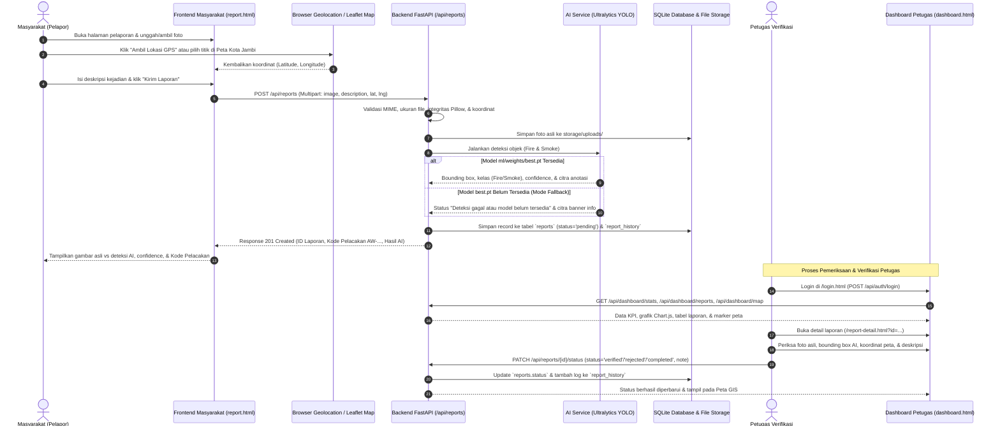
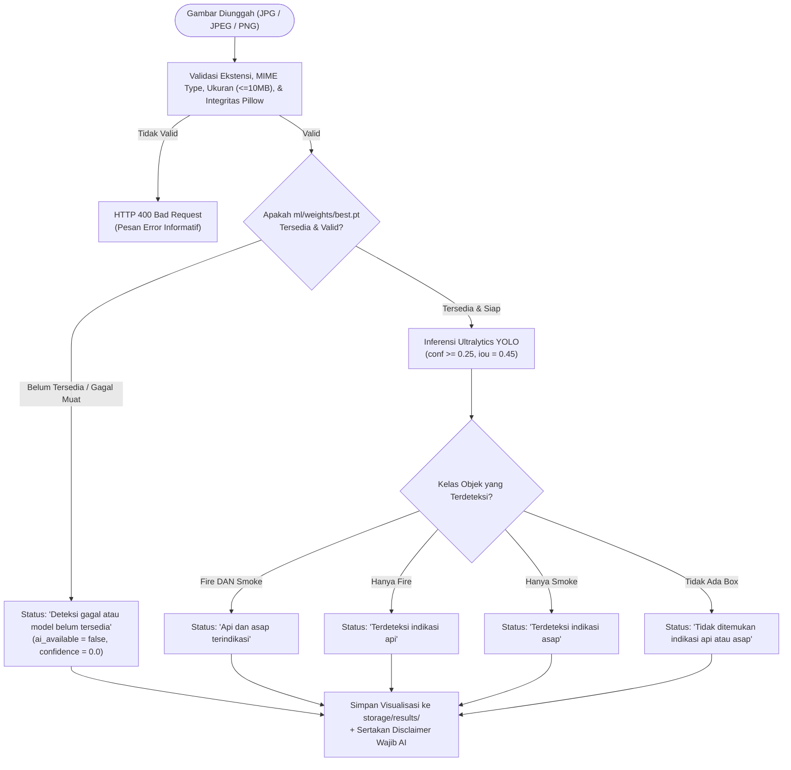

# Diagram Alur Proses Sistem ApiWaspada Kota Jambi

Dokumen ini menjelaskan alur proses operasional aplikasi **ApiWaspada** mulai dari pelaporan masyarakat, pemrosesan Computer Vision YOLO, penyimpanan database, hingga verifikasi oleh petugas dan pemetaan geospasial.

---

## 1. Alur Utama Pelaporan Masyarakat & Verifikasi Petugas



---

## 2. Alur Keputusan Status Indikasi Deteksi AI YOLO



---

## 3. Siklus Hidup Status Laporan (`Report Status Lifecycle`)

```text
                       [ Laporan Baru Dikirim Masyarakat ]
                                        |
                                        v
                                 +-------------+
                                 |   PENDING   | (Status awal otomatis)
                                 +------+------+
                                        |
                   +--------------------+--------------------+
                   | (Verifikasi Petugas + Catatan Wajib)    |
                   v                                         v
            +--------------+                         +--------------+
            |   VERIFIED   |                         |   REJECTED   |
            | (Ditindak-   |                         | (Tidak Valid |
            |  lanjuti)    |                         |  / Bukan Api)|
            +------+-------+                         +--------------+
                   |
                   | (Penanganan Selesai + Catatan Wajib)
                   v
            +--------------+
            |  COMPLETED   |
            +--------------+

  * Setiap transisi status wajib menyertakan catatan petugas dan dicatat secara
    permanen di dalam tabel `report_history` tanpa menghapus riwayat sebelumnya.
```
